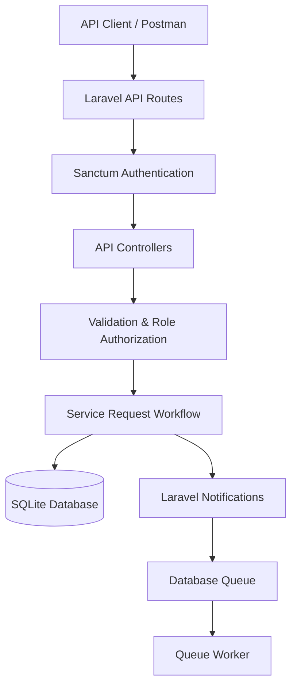
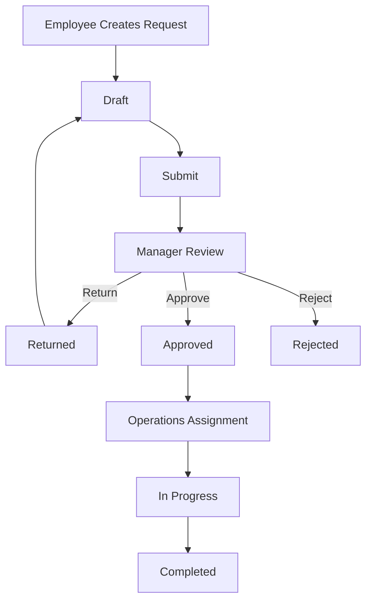

# System Architecture & Design Decisions

## 1. System Architecture

The application follows Laravel MVC architecture. API controllers handle requests and business rules, Eloquent models manage database relationships, and Sanctum provides authentication.

## 2. Request Workflow

The workflow separates responsibilities across three roles.

## 3. Key Design Decisions

| Decision | Rationale |
|---|---|
| Laravel Sanctum | Secure token-based API authentication |
| SQLite | Simple relational database for development |
| Database transactions | Keep workflow updates and audit records consistent |
| Database queue | Process notifications asynchronously |
| Role-based authorization | Restrict actions according to user responsibilities |

**Trade-offs:** SQLite does not provide the same row-level locking as MySQL or PostgreSQL. Assignment events are recorded in the status history table rather than a separate activity table.

**Future improvement:** Introduce a production database with row-level locking, OpenAPI documentation and dedicated activity tracking.
